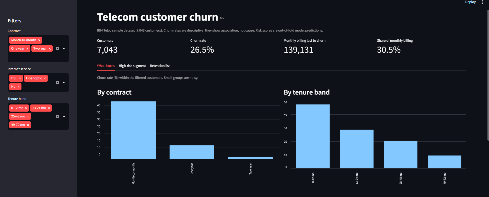
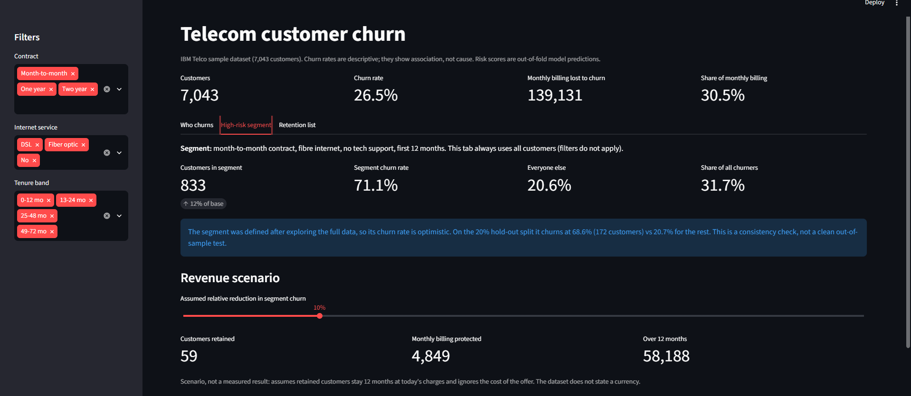
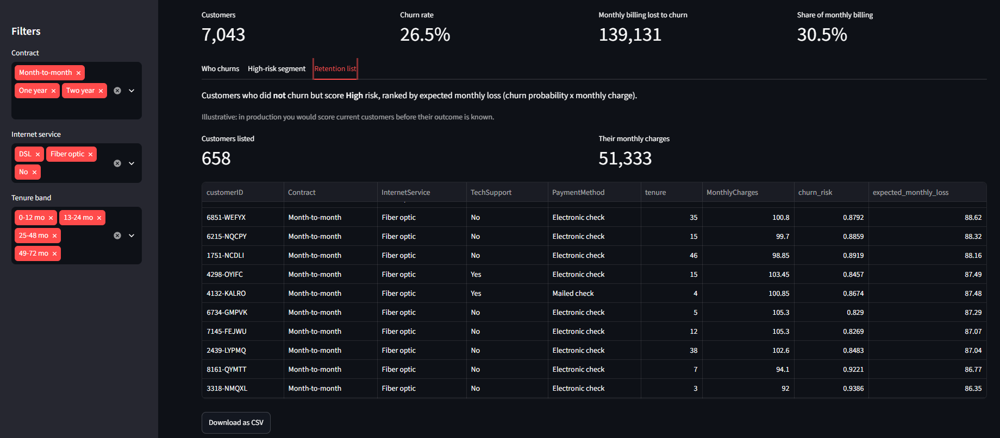

# Telecom Customer Churn: who leaves, why, and what it costs

**Live dashboard:** [https://telco-churn-analysis-28dymgzzbudhy.streamlit.app](https://telco-churn-analysis-28dymgzzbudhy.streamlit.app)

A telecom provider lost 26.5% of its customers (1,869 of 7,043). This project asks which customers are leaving, what they have in common, and where a retention team should spend its effort first. It covers the full path from raw data to a recommendation: cleaning, SQL, statistical testing, a churn-risk model and an interactive dashboard.

**Tools:** Python (pandas, SciPy, scikit-learn) · SQL (SQLite) · Streamlit



## At a glance

- **Highest-risk group:** first-year, month-to-month fibre customers without tech support. They are 12% of customers but churn at **71%**, against 21% for everyone else, and account for **32% of all churners**.
- **Model:** churn-risk scores with ROC-AUC 0.84 (5-fold CV). Customers scored High, Medium and Low actually churned at 62%, 29% and 6%.
- **Recommendation:** target that group with a support-add-on bundle and a contract incentive, and **A/B test it** before any rollout. The data shows association, not cause.

## Key findings

| # | Finding | Evidence |
|---|---------|----------|
| 1 | **Contract type is the strongest single signal.** Month-to-month customers churn at 42.7%, against 11.3% on one-year and 2.8% on two-year contracts. | Chi-square p < 0.001, Cramér's V = 0.41 (the largest of 10 factors tested) |
| 2 | **Churn is an early-life problem.** 55.5% of all churners leave in their first 12 months, when the churn rate is 47.4%. After four years it falls to 9.5%. | Churned customers have a median tenure of 10 months vs 38 for those who stayed (Mann-Whitney p < 0.001) |
| 3 | **Fibre customers without support add-ons are the leakiest group.** Fibre customers with neither tech support nor online security churn at 55.0%. Fibre customers with both churn at 14.2%. DSL customers with both: 6.3%. | 1,765 customers in the worst cell; the pattern holds on both services |
| 4 | **Electronic-check payers churn at 45.3%** versus 15-17% for customers on automatic payment. | Chi-square p < 0.001, Cramér's V = 0.30 |
| 5 | **Gender is irrelevant** (p = 0.49), which is a useful negative control: the tests are not flagging everything. | Chi-square on gender |

**The high-risk segment.** Month-to-month + fibre + no tech support + first year: 833 customers (12% of the base) who churn at **71.1%**, versus 20.6% for everyone else. They make up 31.7% of all churners and $48.5K of the $139K in monthly charges lost to churn. On the 20% hold-out split the same segment churns at 68.6% (172 customers) vs 20.7% for the rest. The rule was defined after exploring the full data, so treat this as a consistency check rather than a clean out-of-sample test.

## Interactive dashboard

The Streamlit app reads the pre-computed files in `outputs/`, so nothing is retrained when it loads. Run it locally with `streamlit run app.py`.

**1. Who churns.** Filter by contract, internet service and tenure band, and see churn rates by contract, tenure, internet service and payment method.


**2. High-risk segment.** Segment size and churn rate, the hold-out caveat, and a slider to test the revenue scenario under different assumptions.



**3. Retention list.** The 658 customers who did not churn but score High risk, ranked by expected monthly loss (churn probability x monthly charge), with a CSV download.



## Recommendation

1. **Target first-year, month-to-month fibre customers** with a bundled offer: tech support and online security, plus an incentive to move to a 12-month contract.
2. **Nudge electronic-check payers towards automatic payment** during onboarding.
3. **Run it as an A/B test, not a rollout.** The add-on and payment gaps are associations in a one-time snapshot. They may partly reflect who chooses those options, so an experiment is needed before claiming the offer causes retention.

**Rough size of the prize:** cutting churn in the high-risk segment by a tenth (a relative 10% reduction, about 59 customers) would protect roughly **$4.8K of monthly billing, about $58K a year**. This is a scenario, not a measured result: it assumes the retained customers stay for 12 months at today's charges and ignores the cost of the offer. The dataset does not state a currency, so $ is assumed. The dashboard's slider lets you change the 10% assumption.

## Approach

| Step | What was done | Where |
|------|---------------|-------|
| 1. Audit and clean | 7,043 rows, no duplicate IDs. 11 blank `TotalCharges` values, all brand-new customers with tenure 0, set to 0. "No internet/phone service" collapsed into "No" for add-on flags. Derived tenure bands, charge tiers, add-on counts. | `src/01_clean.py` |
| 2. SQL analysis | Six business questions in SQLite using aggregation, `CASE`, a CTE and window functions (share of all churners, revenue lost). | `sql/queries.sql`, `src/02_run_sql.py` |
| 3. Statistics | Chi-square tests with Cramér's V as effect size, Mann-Whitney U for tenure and charges. | `src/03_stats_and_model.py` |
| 4. Model | Logistic regression (interpretable) and random forest (flexible), compared on a stratified 80/20 split plus 5-fold cross-validation. Permutation importance for drivers. Out-of-fold risk scores for every customer, so no customer is scored by a model that saw them. | `src/03_stats_and_model.py` |
| 5. Dashboard | Interactive Streamlit app, plus a static chart preview and a Power BI dataset and build guide. | `app.py`, `src/04_dashboard.py`, `docs/powerbi_build_guide.md` |

## Model results

| Model | Test ROC-AUC | 5-fold CV AUC | Recall (churn) | Precision (churn) |
|-------|-------------:|--------------:|---------------:|------------------:|
| Logistic regression | 0.839 | 0.843 ± 0.014 | 0.773 | 0.507 |
| Random forest | 0.839 | 0.842 ± 0.013 | 0.759 | 0.526 |

- **Accuracy is a misleading metric here.** Always predicting "stays" scores 73.5% on the test set; the random forest scores 75.4%. The models are tuned (balanced class weights) to catch churners, so AUC, recall and precision are the numbers to read.
- At the default threshold the model catches about 76% of churners, and about half of the customers it flags do churn.
- **Risk bands behave sensibly.** Customers scored Low churned at 6.4%, Medium at 29.3%, High at 62.4% (out-of-fold scores).
- **Top drivers** (random forest, permutation importance): contract type (0.095 AUC drop when shuffled), tenure (0.051), internet service (0.034). Everything else is below 0.01.
- Logistic regression agrees on direction: fibre optic (odds ratio 2.9) and month-to-month (2.0) raise churn odds, while two-year contracts (0.47) and longer tenure (0.47 per standard deviation) lower them.
- The two models score the same AUC, which suggests the signal is mostly simple rather than hidden in complex interactions.

## Limitations

- **Association, not causation.** This is one snapshot of customers. Add-ons, payment method and contract type are choices customers made, so they may stand in for other things (e.g. price sensitivity).
- **Fibre churns more even after adjusting for the other variables.** The data cannot say whether the cause is price, service quality or competition.
- **Logistic-regression coefficients are partly collinear** (charges overlap with service type, and "Yes"/"No" dummies mirror each other), so I use them for direction only and rank drivers with permutation importance. For example, monthly charges shows an odds ratio below 1 once service type is controlled, which should not be read as "higher bills reduce churn".
- **The high-risk segment was defined after looking at the same data**, so its 71.1% is optimistic; see the hold-out check above.
- **Public sample dataset.** It is the widely used IBM Telco sample, so the value of this project lies in the analysis, not in the data.
- **The retention list is illustrative.** It shows the 658 customers who did not churn but score High risk (about $51K of monthly charges). In production you would score current customers before their outcome is known.

## Reproduce it

```bash
pip install -r requirements.txt
bash run_all.sh        # downloads the raw CSV if missing, then runs steps 1-4
streamlit run app.py   # opens the dashboard at http://localhost:8501
```

On Windows without bash, run the four steps directly:

```powershell
python src/01_clean.py data/telco_raw.csv data/telco_clean.csv
python src/02_run_sql.py data/telco_clean.csv sql/queries.sql outputs
python src/03_stats_and_model.py data/telco_clean.csv outputs
python src/04_dashboard.py data/telco_clean.csv outputs
streamlit run app.py
```

## Project structure

```
app.py       Streamlit dashboard (reads outputs/, nothing is retrained)
data/        raw and cleaned customer CSVs
sql/         queries.sql (six business questions)
src/         01_clean, 02_run_sql, 03_stats_and_model, 04_dashboard
outputs/     SQL results, test results, model metrics, risk scores, charts
             powerbi_dataset.csv = cleaned data + churn_risk + risk_band
docs/        powerbi_build_guide.md, screenshots/
```

**Data source:** IBM Telco Customer Churn sample dataset (`Telco-Customer-Churn.csv`, from the IBM `telco-customer-churn-on-icp4d` repository on GitHub).
